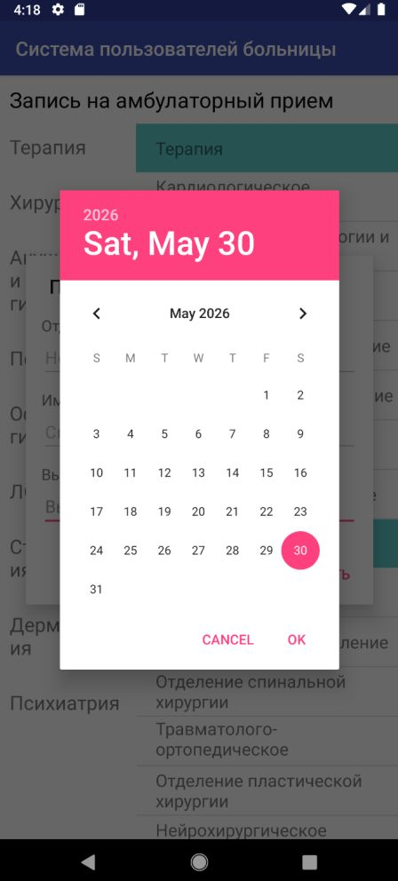
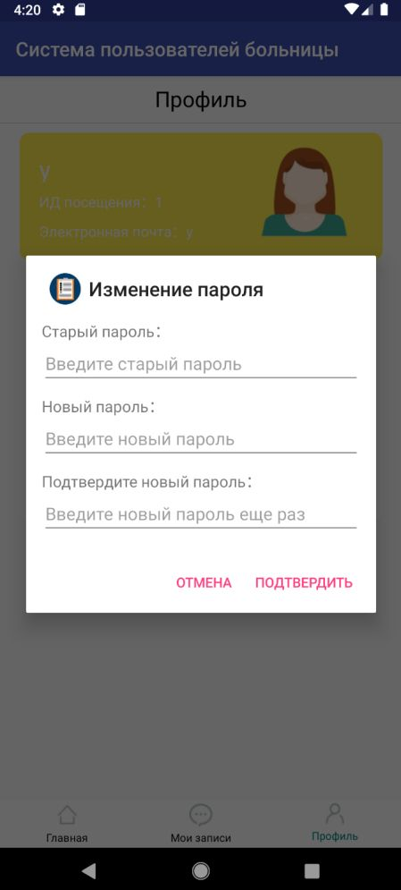
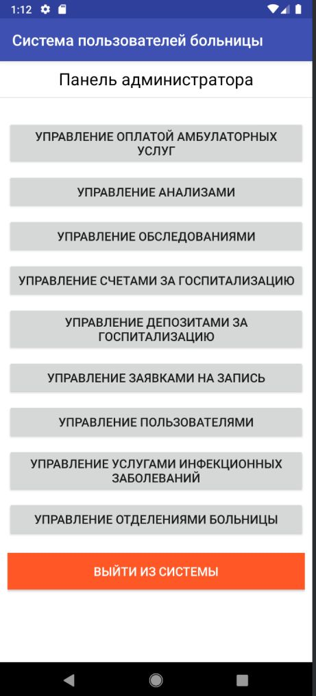

# 安卓医院管理系统

一款安卓端的医院服务 App，界面是俄文的（当时是给俄语地区的项目做的）。患者装上 App 可以自己完成挂号预约、查检查报告、看费用账单、扫码支付这些事，不用每样都跑窗口排队；医院这边有一个管理端，预约、检查、患者、医生、科室这些数据都在里面维护。

功能上覆盖了就诊的主要环节：注册登录之后进首页，各个服务按入口分开；门诊预约支持日历选日期，约好了能在"我的预约"里看；检查报告出来后直接在手机上看结果；账单查询后可以生成支付二维码，扫码完成缴费；另外还做了流行病学调查问卷的填写入口。

对患者来说最直接的变化是报告和账单电子化了，之前纸质单子容易丢，现在随时能翻出来；对医院来说，后台把分散的业务数据集中到一个面板里管理，省了不少沟通成本。

App 用 Java 写的，下面是实际运行时的界面截图。

