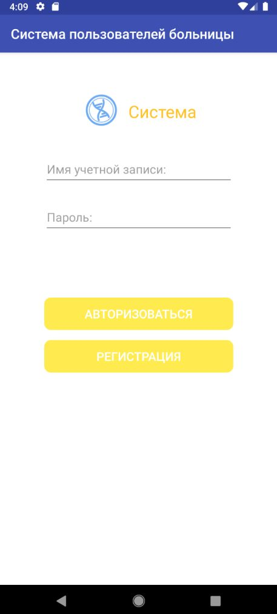
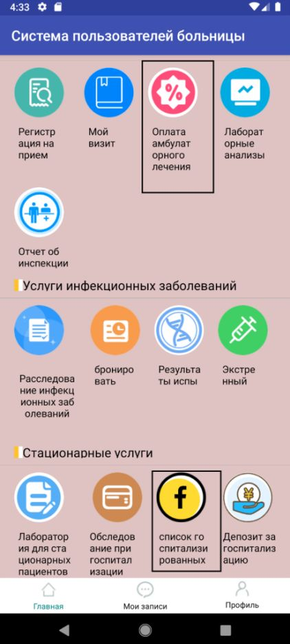
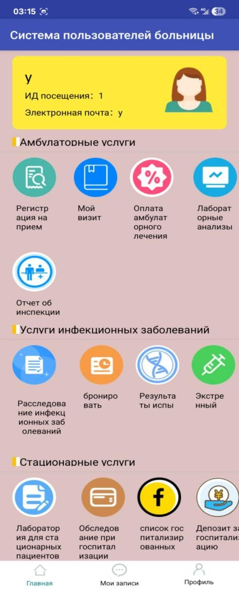
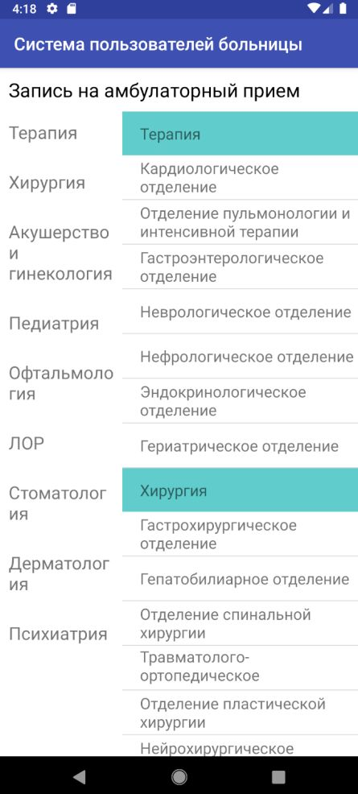
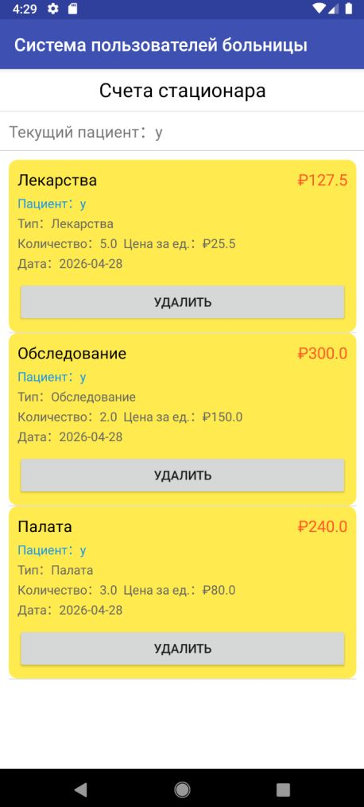

# 安卓医院管理系统

一款安卓端的医院服务 App，界面是俄文的（当时是给俄语地区的项目做的）。患者装上 App 可以自己完成挂号预约、查检查报告、看费用账单、扫码支付这些事，不用每样都跑窗口排队；医院这边有一个管理端，预约、检查、患者、医生、科室这些数据都在里面维护。

功能上覆盖了就诊的主要环节：注册登录之后进首页，各个服务按入口分开；门诊预约支持日历选日期，约好了能在"我的预约"里看；检查报告出来后直接在手机上看结果；账单查询后可以生成支付二维码，扫码完成缴费；另外还做了流行病学调查问卷的填写入口。

对患者来说最直接的变化是报告和账单电子化了，之前纸质单子容易丢，现在随时能翻出来；对医院来说，后台把分散的业务数据集中到一个面板里管理，省了不少沟通成本。

App 用 Java 写的，下面是实际运行时的界面截图。

*登录：患者账号登录入口，就诊数据按账号隔离，手机丢了数据也不混。*

*注册：自助注册建档，不用到医院窗口排队办卡。*

*首页：常用服务按入口分区摆放，预约、报告这些高频功能一眼就能找到。*

*功能导航：挂号、检查、账单、问卷各模块分开导航，覆盖就诊的主要环节。*

*门诊预约：在线填写预约单，替代现场排队挂号。*

*预约日历：日历选日期约号，约好的在"我的预约"里随时能查。*

*检查报告：报告出来直接在手机上看，解决了纸质单容易丢的问题。*

*账单查询：费用明细在线查，每一笔花在哪都清楚，收费透明。*

*扫码支付：生成二维码完成缴费，不用再到收费窗口排队。*

*管理端：医院后台把预约、检查、患者、科室数据集中到一个面板管理，省去科室之间的沟通成本。*
